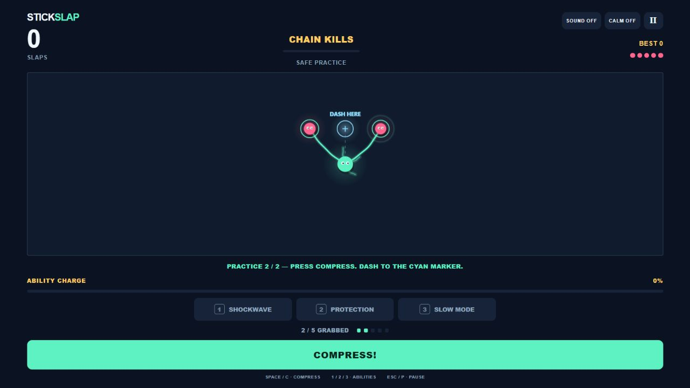

# StickSlap

**[Play the browser demo](https://yum-yum-thighs.github.io/stickslap/)** ·
**[How the prototype works](docs/CASE_STUDY.md)** ·
**[Phase Shift, another prototype](https://yum-yum-thighs.github.io/phase-shift/)**

Grab the crowd. Choose your escape. Crush everything together.

A music-reactive tentacle survival game. Movement comes entirely from compression:
the enemies you choose also determine where you dash. Try the safe practice round
to learn the core interaction before entering a real run.



## Play

- Click/tap enemies or bombs to attach a tentacle. Tap again to detach.
- Grab at least two targets, then press **COMPRESS**, **Space**, or **C**.
- The cyan marker and dotted line show the mass-weighted dash destination.
- Chain kills within **3 seconds** to fill your ability bar.
- At 100% charge: **1** shockwave, **2** protection, **3** slow mode.
- A health pack appears only at **1 HP**. Pull it into a dash to recover **2 HP**.
- **Escape / P** pauses; **R** replays after game over.
- Sound starts off. Enable it to hear the original score. Beat timing continues
  when muted, so muting does not change difficulty.
- **Calm** reduces pulsing and removes screen shake. First use respects your
  operating system's reduced-motion setting.

Five tentacles, bomb chains, escalating waves, saved best scores and touch buttons
are included. Leaving the window or tab pauses active play.

## Run locally

Node.js 20 or newer is sufficient; there are no dependencies or build steps.

```sh
npm start
npm test
```

Open the printed address, normally http://127.0.0.1:5187. You can also open
index.html directly. The Windows start-preview.cmd launches the optional server.
See [verification](verification/README.md) for checks and device limits.

## Source and hosting

simulation.js owns the independent game rules. game.js owns Canvas rendering,
input, safe practice, sound and interface state. Read [the case study](docs/CASE_STUDY.md)
for the weighted-center calculation, feedback and code walkthrough.

The score is synthesized by tools/generate-music.cjs. Run npm run music to
regenerate the WAV and its energy/beat map. No third-party music recordings or
samples are included in this public release.

GitHub Pages serves main from the repository root. .nojekyll keeps the game
buildless. Runtime asset paths are relative, so it can also be placed inside a
website subdirectory. To embed the demo:

```html
<iframe src="https://yum-yum-thighs.github.io/stickslap/"
        title="StickSlap game" width="100%" height="800"
        allow="fullscreen" loading="lazy"></iframe>
```

## Attribution and scope

An AI-assisted gameplay prototype by [yum-yum-thighs](https://github.com/yum-yum-thighs).
The concept, creative direction and iteration requests came from the creator;
implementation and review used substantial AI assistance. Source and tests are
provided for portfolio inspection. See [CREDITS.md](CREDITS.md).

Circular bodies and bounded forces are arcade approximations. Physical phone
hardware and a broader device range still need testing.
